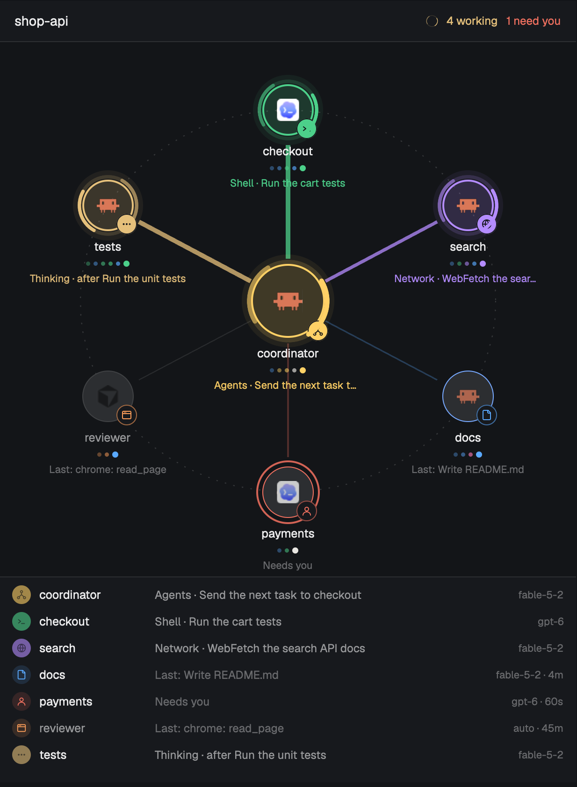

# Agent Map

A live map of the agents in a [Herdr](https://herdr.dev) space: who works, on what, with which kind of tool.



*The picture shows the mod's demo data (`props { demo: true }`), not a real project.*

## What it shows

- **One node per agent** of the space on screen, with its program's logo. If one agent started the others (a coordinator), it sits in the middle with its workers around it. If not, the space is the hub.
- **The kind of work, by color:** files blue, shell green, network purple, browser orange, agents yellow, skills pink, memory teal. Three dots mean the agent is thinking.
- **Motion:** a working agent has a ring that turns. When it starts a call, a pulse in that color flies out along its spoke; when the call ends, a pulse flies back; when it finishes its turn, a wide ring leaves it.
- **History:** a row of beads under each name shows the last calls. A spoke is thicker when the agent was busier in the last five minutes.
- **A list** under the map: one row per agent, the latest first, with its model. A click on a node or a row shows that agent.

## Where the data comes from

Statuses and who started whom come from Herdr. What an agent does comes from its local transcript, read by `agents.py` every 2 seconds while the map shows: Claude Code (`~/.claude/projects/...`) and Codex (`~/.codex/sessions/...`). Nothing leaves your computer.

## Install

Built and tested on **Herdr app 0.1.16 with herdr-core 0.1.21**, macOS. Needs `python3` on your PATH (standard library only).

Ask your agent in Herdr:

> Add the mod herdr.dev/mods/klinter007/herdr-agent-map

Or by hand:

```sh
git clone https://github.com/klinter007/herdr-agent-map
cp -R herdr-agent-map/mods/agent-map ~/.config/herdr-app/mods/
herdr-app check ~/.config/herdr-app/mods/agent-map
herdr-app do pane.split '{"direction":"right","mod":"agent-map"}'
```

To keep it as a side panel, add this block to the row of your own layout that holds your panes:

```json
{ "id": "agent-map", "type": "block", "size": { "px": 460 }, "content": { "mod": "agent-map" } }
```

## Limits

- Two agents in the same folder: which transcript belongs to which agent is a guess.
- Agents other than Claude Code and Codex show their status, without the kind of work.
- A coordinator sits in the middle only when Herdr lists it as an agent of the same space.

## Credit

The idea and the stations follow [lot-map](https://github.com/alexeyw/lot-map) by alexeyw (MIT), which draws one Claude Code session this way. Agent Map is new code for Herdr and draws a whole space.

## License

MIT
