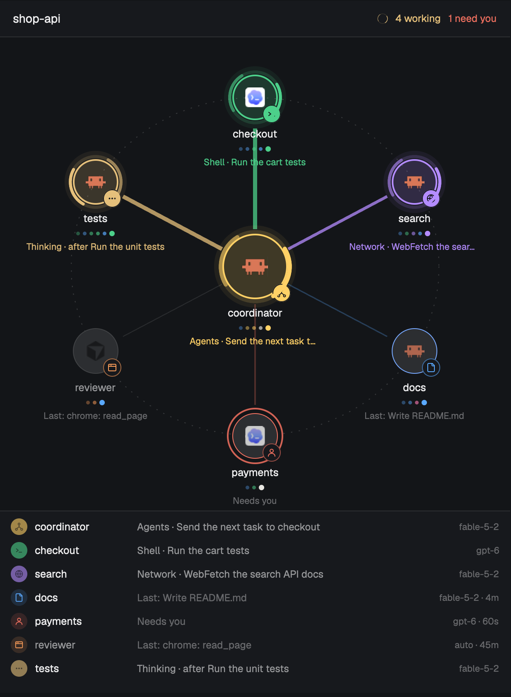

# Agent Map

A person opens it beside their work and sees every agent of the space as a node on a ring: which ones work, what kind of tool each one uses now, and what the call is. Pulses fly along the spokes as calls start and end.

**What you see:**

- A header 40 px high: the space's name; at the right a small turning arc and "N working" in the theme's `working` color, and "N need you" in `blocked` when any do.
- The map on `theme().canvas`: a dotted ellipse; a hub in the middle; one node per agent on the ellipse.
  - The hub with no coordinator: a 72 px disc with the count of working agents (or of agents) and the space's name under it. With one coordinator (the only agent that started others) the hub is that agent's node, 72 px.
  - A node: a 50 px disc with the program's logo in full color (`icons/claude.svg`, `codex.svg`, `cursor.svg`, `pi.svg`, `gemini.svg`, `grok.svg`, else `icons/agent.svg`; 45% opacity when idle). A 20 px badge on its lower right corner holds the icon of the kind of work, filled with that kind's color while the call runs. Under the disc: the name (11.5 px), a row of up to 7 beads (4 px, the newest 6 px), and one line (10 px) such as "Shell · Run the cart tests", "Thinking · after …", "Needs you", "Last: …".
  - Colors by kind: files `#5aa9ff`, shell `#4cd08a`, network `#b48cff`, browser `#ff9f5a`, agents `#ffd166`, skills `#ff7ab6`, memory `#62c7ba`, you `#e8e6e1`, other `#9aa0aa`; thinking uses `theme().working`.
  - Spokes from the hub's rim to each node's rim, 1 px plus 0.4 px per call in the last five minutes (8 at most), in the kind's color while the agent works.
- A list under the map, at most 200 px high: per agent an 18 px colored chip with the kind's icon, the name (104 px wide), the line, and at the right the model and the age of the last call.

**How it behaves:**

- working: a soft glow that breathes (opacity loop, 1500 ms) and a thin arc that turns around the disc (1300 ms; 2600 ms while thinking). blocked: a red ring that beats (900 ms) and the line "Needs you". done: the disc's edge in `theme().done`. idle: dim.
- A call starts: four dots with a tail fly from the hub (or the parent) to the node in 750 ms, then a ring spreads there. The call ends: the dots fly back. The turn ends: a wide white ring leaves the node (1100 ms).
- A click on a node or a row runs `agent.focus { terminal }`.
- As a panel (`props { panel: true }`, a child `agentmap` of a `panel-body` stack) it reads transcripts only while that child shows. `props { demo: true }` shows a made-up team and reads nothing.

**Built from:**

- `mods/agent-map/`: `main.js`, `agents.py`, `mod.json`, and the icons `files, shell, network, browser, agents, skills, memory, you, tool, ai, arc` (`.svg`).
- `herdr`: `agents()` (address, space, status, app, tab_name, seq), `terminals()` (cwd, parent, name), `spaces()`, `theme()`, `settings()` (zoom), `exec`, `appHome`, `run`, `props`, `layout`.
- `agents.py '<json list of {address, agent, cwd, status}>'` prints per address `{station, tool, label, running, call, model, ctx, trail, recent, age}`. It reads the last 400 KB of the transcript: Claude Code `~/.claude/projects/<cwd with every non-alphanumeric as ->/*.jsonl` (`tool_use` / `tool_result` blocks), Codex `~/.codex/sessions/*/*/*/rollout-*.jsonl` (`function_call`, `custom_tool_call` and their outputs; the first line names the cwd). A shell command is files, network or shell by its first word.
- Drawing: nodes and flying dots are absolutely placed `div`s; spokes and the ellipse are `window.paint_path(PathBuilder…)`; the arc is an `svg().spin()`; glows use `.loop("opacity", …)`. One `cx.timer.every(33)` redraws only while a pulse is in flight; a second one polls every 2000 ms.

**Watch out:**

- Path coordinates follow Herdr's zoom (0.1.16): do not multiply them by the zoom. Sizes from `on_size_change` are real px: divide by the zoom.
- `.loop` swings one property; two loops on one element do not move it along a line. That is why the pulses are drawn by the timer.
- Agents that share a folder get that folder's newest transcripts, working agents first: a guess.
- A parent that Herdr does not list as an agent of the space is not drawn as a coordinator.

**Done when:**

- `herdr-app check ~/.config/herdr-app/mods/agent-map` passes.
- With `props { demo: true }` it shows seven agents, the coordinator in the middle, four of them working.
- In a space with a working Claude Code agent, its node shows the kind and the name of the running call within 2 seconds, and a pulse flies when the next call starts.
- A click on a node shows that agent.
